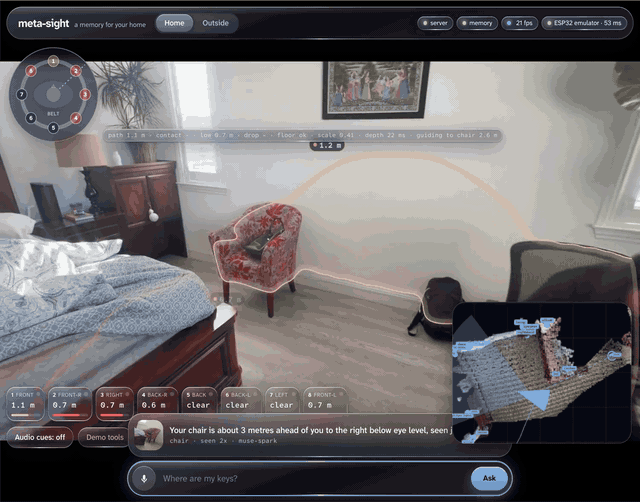
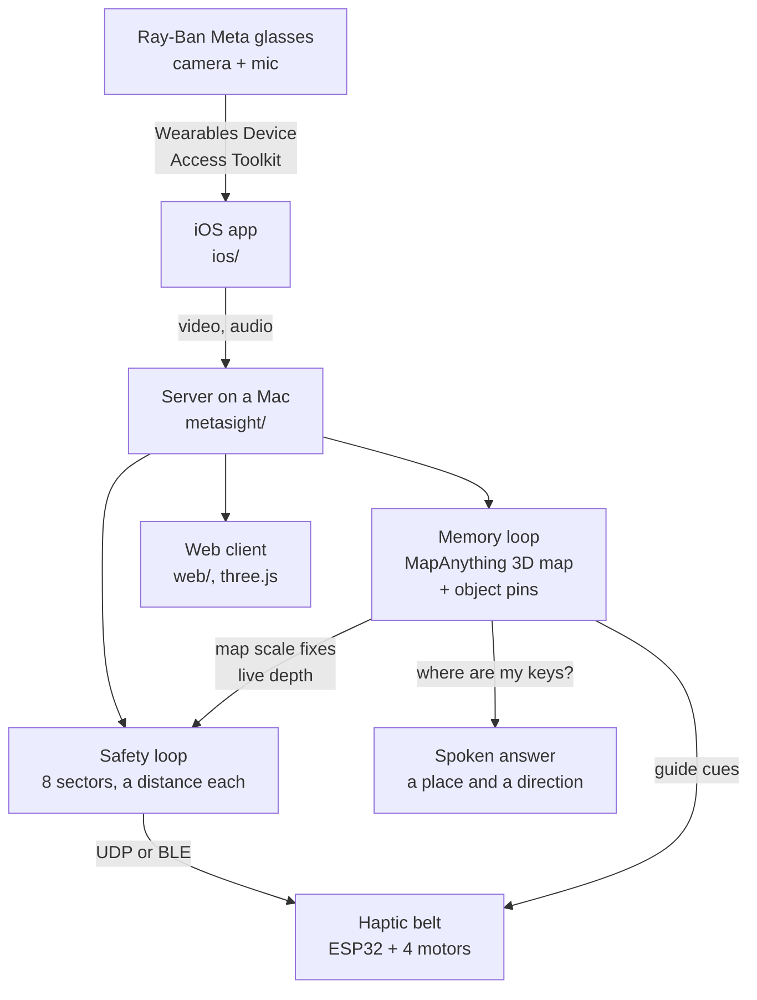
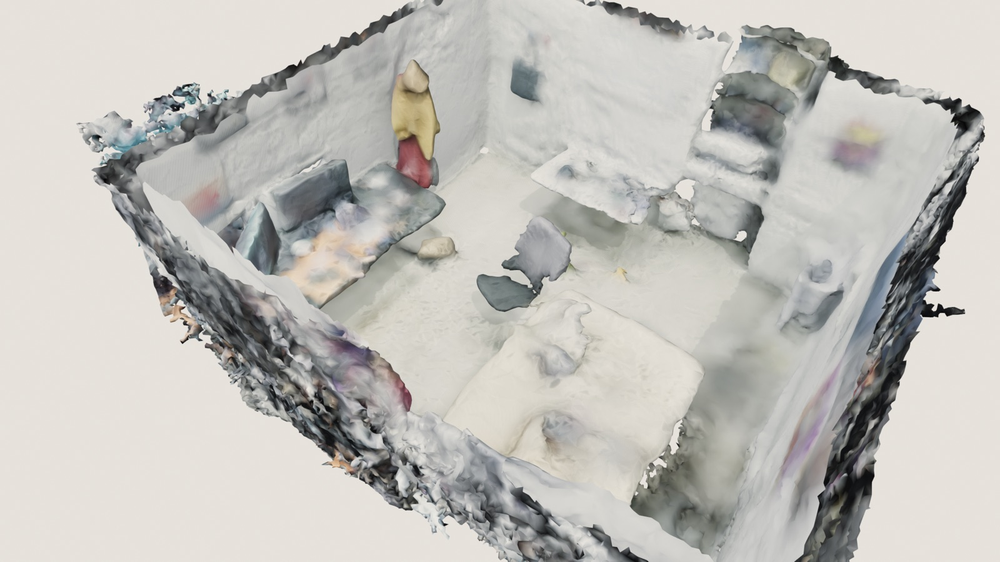
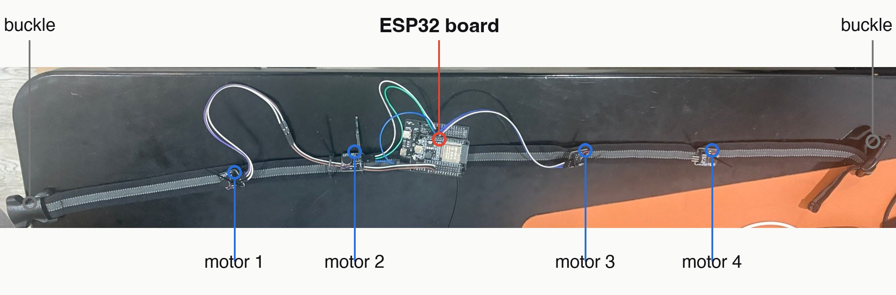
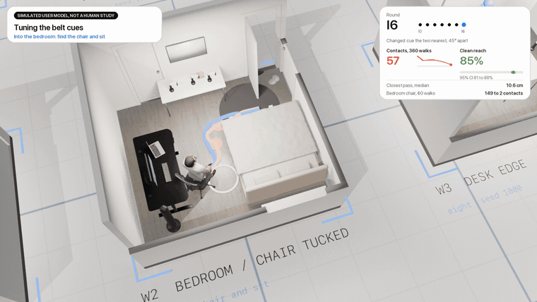

# Navi

I built Navi for my grandpa, whose eyesight keeps getting worse. He wears Ray-Ban Meta glasses, a server on a Mac does the seeing, and a small haptic belt around his waist buzzes on the side where something is in his way. He can also ask out loud where he left his keys, and Navi answers with a place and a direction.

<p align="center">
  
</p>
<p align="center"><sub>A real walk through my room in the web client. The ring in the corner is the belt, the chair gets a red outline at 0.6 m, the 3D map sits bottom right, and the answer to "where is my chair" runs along the bottom.</sub></p>


## Why it needs a memory

On a 74.5 s walk around my room, the average object was out of the camera's view 85% of the time (23 objects, `bench/results/compare/out_of_view.json`). A detector that only looks at the current frame has nothing to say about them. Navi keeps a map, so it can still point at the keys after you've turned away from them.

## How it works



The iOS app in `ios/` streams camera and microphone from the glasses to the server over Meta's Wearables Device Access Toolkit.

On the server (`metasight/`), a fast safety loop splits the view into sectors and gives each one a distance. A slower memory loop builds a metric 3D map of the home and pins the objects it sees, which is how "where are my keys?" gets its answer.

The belt runs ESP32 firmware from `firmware/belt/` and pulses faster as an obstacle gets closer. The web client in `web/` (TypeScript and three.js) shows the live map, the sectors and the belt.

## The 3D map

<p align="center">
  
</p>
<p align="center"><sub>The bedroom map Navi built from a walk with the glasses.</sub></p>

Keyframes go to MapAnything, and the windows get stitched into one metric map of the house. Objects the finder sees are pinned with a label, a position, a time and a thumbnail. The map also checks the live depth: on the test walks, using its scale cut the median distance error from 34% to 16%.

## The belt

<p align="center">
  
</p>

An ESP32 board sits in the middle of the strap with four vibration motors spread around the waist (front-right, back-right, back-left, front-left). The server sends a cue for each of eight directions. A direction that falls between two motors plays on both at about 71% each, so it feels as strong as one. If no command arrives for 250 ms, the belt goes quiet.

What each cue feels like (`firmware/belt/belt_core.h`):

| Cue | When | Pattern |
| --- | --- | --- |
| off | nothing within 2 m | no buzz |
| slow | something 1 to 2 m away | 200 ms taps, 1.5 a second |
| fast | 0.5 to 1 m | 4 pulses a second |
| solid | closer than 0.5 m | constant buzz |
| guide | walking toward a waypoint or a remembered item | two soft taps a second |
| find | looking for an item | short sharp ticks, 2.5 a second, stronger as you get closer |
| talk | someone is speaking | three soft taps every 1.5 s, toward the voice |
| arrived | you reached the item | one motor at a time, all the way round |

Walking straight at something (under 1.2 s to contact) bumps the front cue up one step, so it warns earlier than when you're just standing beside it. A drop-off ahead plays on the front motor over everything else. A direction with no trusted data stays silent, and the app says so.

## Meta models it runs on

| Job | Model |
| --- | --- |
| 3D map from keyframes | MapAnything |
| Image features for matching places and objects | DINOv2 |
| One-sentence answers to questions | Muse Spark |
| Reviewing what changed in the map | Muse Wonder |
| Speech to text | Muse Voice Transcribe |
| Finding small objects | SAM 3.1 |
| Local language model, runs offline | Muse Glimmer |
| Cleaning up microphone audio | Meta denoiser (dns48) |

Each model sits behind a small interface and is picked in `metasight.toml`.

## Run it

You need a Mac with Apple silicon, Python 3.12 with `uv`, and Node with `pnpm`.

1. Install and build:

   ```sh
   uv venv --python 3.12 && uv pip install -e ".[dev]"
   (cd web && pnpm install && pnpm build)
   ```

2. Start the server:

   ```sh
   scripts/run.sh                   # http://127.0.0.1:8444, open it in a browser
   ```

3. To use a phone camera, you need HTTPS. Make a self-signed certificate for your LAN address with `scripts/make_cert.sh`, run `scripts/run.sh CERT KEY`, then open `https://<mac ip>:8443` on the phone and accept the certificate.

4. No camera? Replay a video: `python scripts/replay.py clip.mp4 --ask "where is the remote"`. To build a map offline: `python scripts/build_map.py clip.mp4`.

The Meta models need `META_API_KEY` in the environment or the macOS Keychain. Keys are never written to a file. Model weights, room scans and recorded footage are not in this repo.

Tests: `python -m pytest`.

## Simulation numbers

<p align="center">
  
</p>

The belt patterns were tuned in a walking simulation (results in `bench/results/`). These come from a simulated user model, not a human study. Across 360 simulated walks per round, the tuning took bumps from 467 to 57 and clean walks from 19% to 85%.

## License

MIT, see `LICENSE`. The iOS app builds on Meta's Camera Access sample; see `ios/THIRD_PARTY.md` for its terms.
